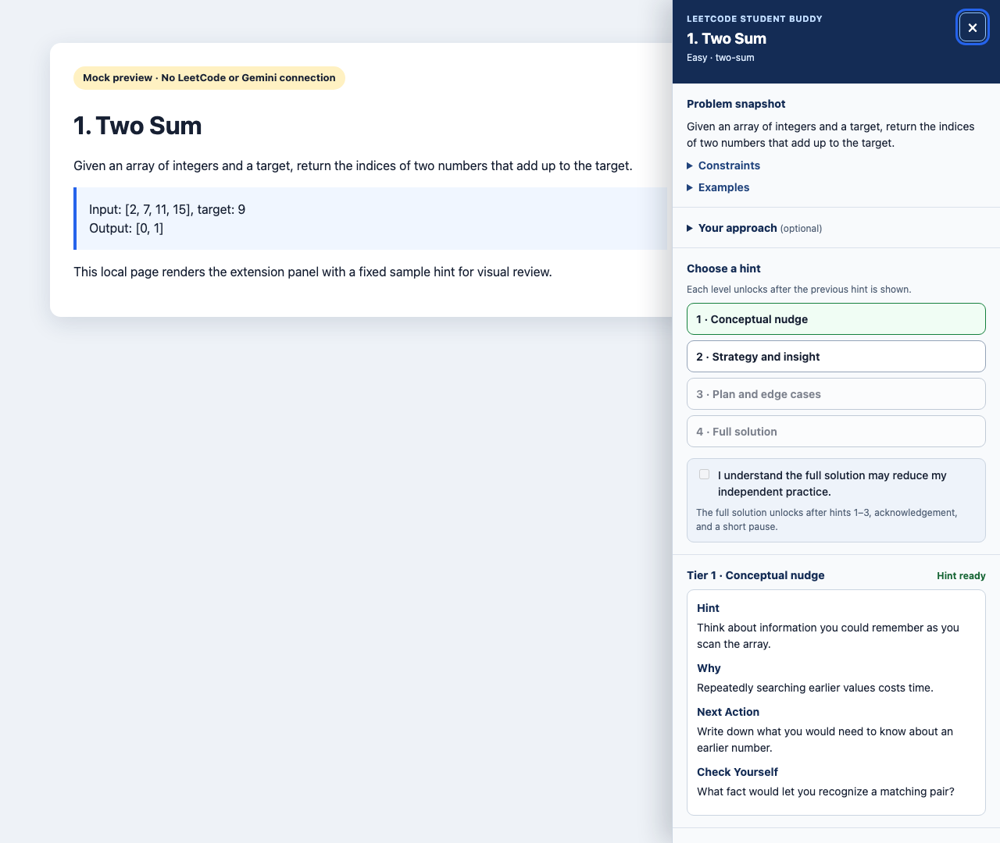

# LeetCode Student Buddy

A Chrome Manifest V3 extension that adds a guided hint panel to LeetCode problem pages. It requests four progressively more revealing hints from Gemini. The first three hints aim to preserve the student's reasoning; the full solution requires those hints, an acknowledgement, and a 12-second pause.



*This screenshot was rendered in headless Chrome from [a local preview](docs/demo-preview.html) with a fixed response. It is a visual fixture, not a live LeetCode or Gemini capture.*

## Project highlights

- **Progressive learning:** four hint tiers, with an acknowledgement and cooldown before the full solution.
- **Browser engineering:** Manifest V3 service worker, per-tab session state, and handling for LeetCode navigation and stale responses.
- **Defensive API integration:** request timeouts, readable errors, response validation, and API keys kept out of page scripts.
- **Stack:** JavaScript ES modules, HTML/CSS, Chrome Extension APIs, Gemini REST API, Node.js tests, jsdom, ESLint, and GitHub Actions.

## Install and try it

1. Use Chrome 102 or newer. Clone or download this repository. No build step is needed for the extension.
2. Open `chrome://extensions`, turn on **Developer mode**, choose **Load unpacked**, and select the repository root (the folder containing `manifest.json`).
3. Open the extension popup. Paste a Gemini API key, leave the default model or enter a model available to your key, and click **Save**. **Test connection** sends a small request to Gemini and may count toward API usage.
4. Open `https://leetcode.com/problems/two-sum/` (or another problem). Click **Open Student Buddy** in the lower right. If the description is still loading, wait for **Ready for hint 1**.
5. Request hints in order. After hint 3, acknowledge the warning and wait for the solution button to enable.

The configured default model is `gemini-3.8-flash`; its availability has not been verified. Choose a model available to your key using the [Gemini model documentation](https://ai.google.dev/gemini-api/docs/models), and update the model field in the popup if needed. The API key is passed in the [`x-goog-api-key` header](https://ai.google.dev/api), rather than in the URL.

For a key-free visual preview, open [docs/demo-preview.html](docs/demo-preview.html) locally in Chrome. The page supplies sample context and a fixed Tier 1 response; it does not exercise extension injection or the Gemini API.

## How it works

| Part | Responsibility |
| --- | --- |
| `content/context-extractor.js` | Reads the scoped LeetCode description, title, difficulty, examples, and constraints. It waits when the description is absent and rejects a title that does not match the current problem URL. |
| `content/content.js` and `content/content.css` | Render the sidebar, optional notes, hint controls, loading/error states, keyboard-close action, and navigation updates. The panel polls the problem URL and discards responses from the previous problem. |
| `background/service-worker.js` and `background/hint-controller.js` | Own per-tab progression in `chrome.storage.session`. The worker checks the sender URL and request context, enforces tier order and the solution gate, and advances only after an accepted model response. |
| `background/prompt-builder.js` and `background/response-policy.js` | Give each tier a distinct instruction and reject pre-solution responses with missing sections, extra headings, obvious code, or excessive length. |
| `background/gemini-client.js` | Calls Gemini with a timeout and user-facing errors that do not expose response bodies or the key. |
| `popup/*` and `background/settings.js` | Configure and test the key, model, and hint detail. An older key in sync storage is migrated to local storage and removed from sync. |

The worker ignores client-supplied completion and cooldown flags. It passes earlier accepted hints into later prompts to reduce repetition. Its session state survives service worker suspension, while a page reload or navigation starts a fresh progression. Only one hint request per active problem session runs at a time; a new problem can begin while an old request finishes.

## Privacy and security

- The key and optional reflection notes are stored in `chrome.storage.local` on this browser. The key is never returned to the content script or written to logs. The worker limits local and legacy sync storage access to trusted extension contexts with `setAccessLevel` ([Chrome storage behavior](https://developer.chrome.com/docs/extensions/reference/api/storage)). **Local extension storage is not encrypted by this project**; someone with access to the browser profile or extension DevTools can inspect it. Clear the key in the popup if using a shared machine.
- Progress and earlier hint text are held in `chrome.storage.session`, together with the problem slug, acknowledgement, and cooldown time. They clear when the extension or browser session ends. Reflection notes are saved per problem slug until you remove the extension or clear extension storage.
- A hint request sends the problem title, URL, up to 6,500 characters of statement, up to four examples, up to eight constraints, and optional notes (up to 800 characters per field) to Google Gemini. **Test connection** sends a short test prompt. This project has no analytics or telemetry. Google handles API requests under its own terms and privacy policies.
- The extension requests `storage` permission, injects only on `https://leetcode.com/problems/*`, and has host access only to `https://generativelanguage.googleapis.com/*`.

## Checks and evidence

```bash
npm ci
npm run lint
npm test
npm audit
```

The test suite and lint checks can be run locally with the commands above. Dependency audit results can change as new advisories are published. The tests cover scoped context extraction, SPA navigation with a late response, tier spoofing, cooldown after worker recreation, key migration and transport, output validation, escaping, and storage access. [GitHub Actions CI](.github/workflows/ci.yml) runs `npm ci`, lint, and tests on pushes and pull requests; no remote CI run is claimed here.

## Limitations

- LeetCode changes its DOM and routes over time. Extraction uses known description selectors and may need maintenance. A problem without a readable description will not generate a hint.
- Gemini can still reveal a solution in ordinary prose or produce an incorrect answer. The pre-solution validator blocks obvious code and format violations, but it cannot prove a hint is spoiler-free or correct. Retry the tier if the validator rejects a response.
- Anyone who controls their own extension storage or DevTools can deliberately defeat client-side learning gates. These controls protect the normal product flow, not against a malicious local user.
- A headless Chrome attempt to load the unpacked extension on the live Two Sum page timed out without exposing the problem description or injected panel in its DOM dump. The screenshot and navigation tests therefore use mocks. Live LeetCode injection, selector accuracy, and the end-to-end Gemini flow remain unverified; no API key was available for a real Gemini request.

See [DEMO_SCRIPT.md](DEMO_SCRIPT.md) for a short walkthrough and a key-free fallback.

## License

[MIT](LICENSE).
